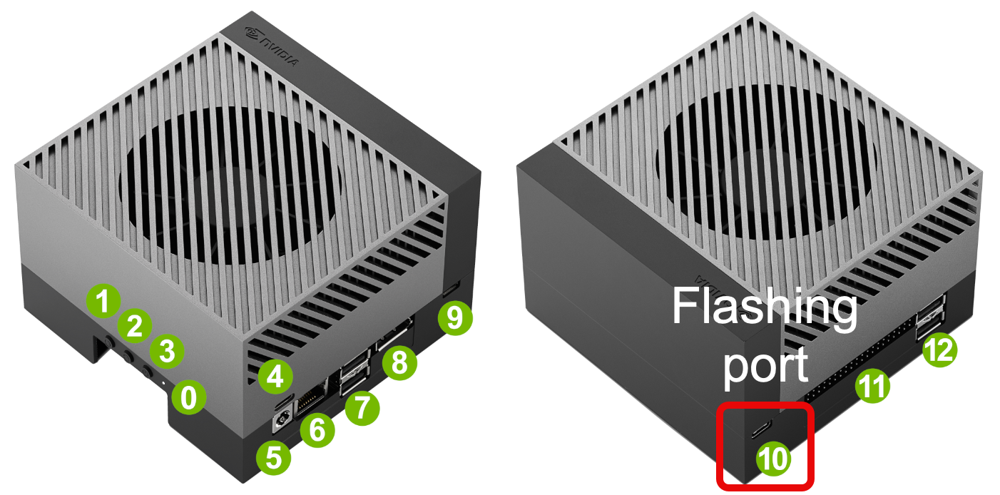
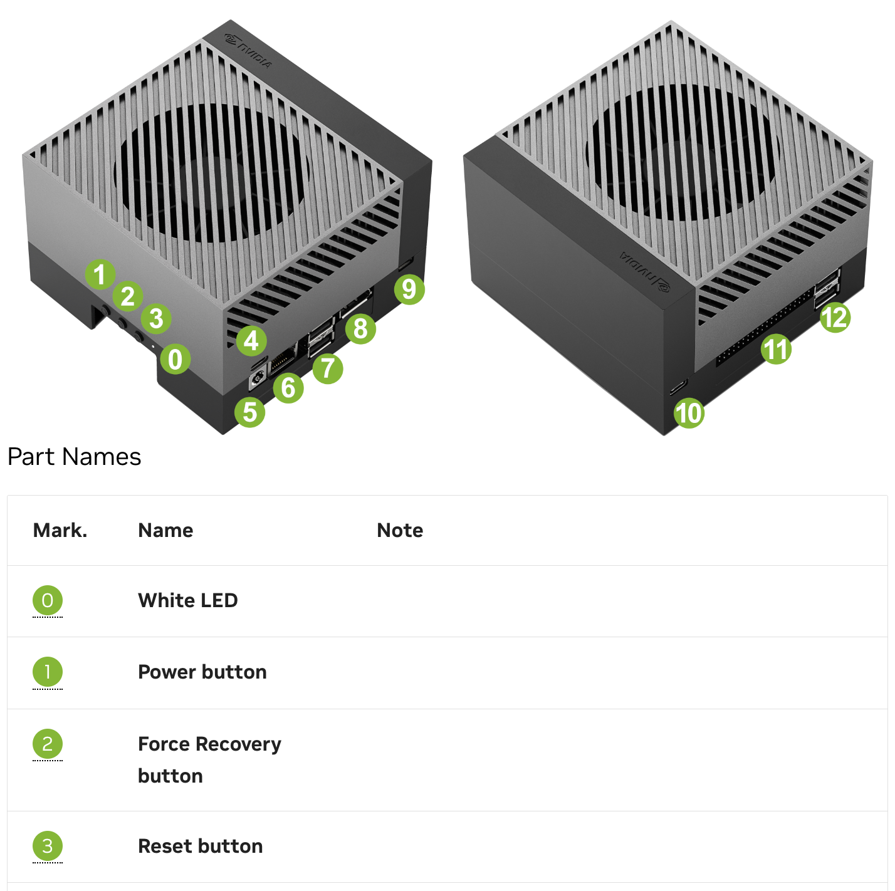

# Nvidia Jetson AGX Orin Developer Kit Setup with JetPack 7

Nvidia Jetson embedded computer boards are used on robots and drones to
behave as smart cameras.

JetPack 7.2 is the first JetPack 7 release that supports Orin. These steps
were verified on a Jetson AGX Orin 64GB Developer Kit with JetPack 7.2.2,
flashed with SDK Manager. For JetPack 6, see
[NVIDIA_JETPACK_6_JETSON_DEVELOPER_KIT_SETUP.md](NVIDIA_JETPACK_6_JETSON_DEVELOPER_KIT_SETUP.md).

What changes from JetPack 6:

| | JetPack 6.2 | JetPack 7.2.2 |
|---|---|---|
| Jetson Linux (L4T) | R36.4 | R39.2.2 |
| Ubuntu | 22.04 | 24.04 |
| Kernel | 5.15 | 6.8 |
| CUDA / cuDNN / TensorRT | 12.6 / 9.3 / 10.3 | 13.2 / 9.20 / 11.4 |
| Install methods | SDK Manager | SDK Manager or a bootable Jetson ISO USB stick |
| SDK Manager host | Ubuntu 20.04 or 22.04 | Ubuntu 22.04 or 24.04 |
| Ethernet interface | `eno1` | `end0` |
| `vcan` module | needs `linux-modules-extra` | ships with the kernel |
| Docker + NVIDIA Container Toolkit | | installed by SDK Manager |
| KVM guests | work | need `-cpu host,pauth=off` (see below) |

Helpful video from JetsonHacks YouTube channel on unboxing and setup:
https://www.youtube.com/watch?v=LUxyNyCl4ro

The base still leaves most of the carrier board exposed. StereoLabs sells a
metal enclosure that also has room for their capture board:
https://store.stereolabs.com/products/enclosure-for-orin-agx-devkit

The only way to connect a display to the AGX Orin Developer Kit is via
DisplayPort. If you need HDMI output, you'll need to have a
DisplayPort (male) to HDMI (female) adapter handy. Some KVM switches only get
640x480 through an adapter. The workaround is in the
[nvidia-training deck](https://github.com/taylorific/nvidia-training).

The Orin can be powered via USB-C on the back, or with the included power
brick and a barrel connector.

Moving towards minimizing the desktop GUI that comes with the developer
kit when it ships to basically run Ubuntu server instead of desktop:

https://nvidia-ai-iot.github.io/jetson-min-disk/step1.html

## First steps - verify the Jetson is booting off NVMe and has at least 2TB of storage

### Verify that JetPack 7.2.x (or higher) is present

If you think your Jetson Developer Kit has already been configured, double
check to make sure the system has the desired JetPack version and there is
adequate storage.

```bash
$ grep PRETTY_NAME /etc/os-release
PRETTY_NAME="Ubuntu 24.04.5 LTS"

$ cat /etc/nv_tegra_release
# R39 (release), REVISION: 2.2, GCID: 48648412, BOARD: generic, EABI: aarch64, DATE: Fri Nov 13 07:17:33 AM UTC 2026
# KERNEL_VARIANT: oot
TARGET_USERSPACE_LIB_DIR=nvidia
TARGET_USERSPACE_LIB_DIR_PATH=usr/lib/aarch64-linux-gnu/nvidia
```

`R39 ... REVISION: 2.2` is Jetson Linux 39.2.2, which is JetPack 7.2.2.

```bash
$ apt-cache policy nvidia-jetpack | head -3
nvidia-jetpack:
  Installed: (none)
  Candidate: 7.2.2-b56
```

SDK Manager installs the JetPack components individually, so `nvidia-jetpack`
shows `(none)` even on a complete install. Check the components themselves:

```bash
dpkg -l cuda-toolkit-13-2 libcudnn9-cuda-13 tensorrt | grep ^ii
```

### Verify that the boot drive is the NVMe device

`efibootmgr` is already installed on JetPack 7. NVMe should be first in the
boot order:

```bash
# cut drops the device paths that efibootmgr prints after a tab
$ efibootmgr | cut -f1
BootCurrent: 0001
Timeout: 5 seconds
BootOrder: 0001,0000,0002,0003,0004,0005,0006,0007,0008
Boot0000* Enter Setup
Boot0001* UEFI Samsung SSD 990 PRO 4TB S7KGNJ0WC15702M 1
Boot0002* UEFI Micron G1M15M 1A812F20 eMMC User Data
Boot0003* UEFI PXEv4 (MAC:48B02DDCCCA5)
Boot0004* UEFI PXEv6 (MAC:48B02DDCCCA5)
Boot0005* UEFI HTTPv4 (MAC:48B02DDCCCA5)
Boot0006* UEFI HTTPv6 (MAC:48B02DDCCCA5)
Boot0007* BootManagerMenuApp
Boot0008* UEFI Shell
```

And the root filesystem is on it:

```bash
$ findmnt -n -o SOURCE /
/dev/nvme0n1p1

$ grep BOOT_STORAGE /etc/nv_boot_control.conf
TEGRA_BOOT_STORAGE nvme0n1
```

If any of these are wrong, reflash with one of the two methods below.

## Remedy - install an NVMe drive and flash

The Jetson Developer Kits are configured to boot and run the OS off the
built-in eMMC drive. The eMMC drive is fairly small, and eMMC is slow. So
it is better to just reconfigure the system so it boots off the secondary
NVMe drive exclusively and ignores the eMMC device. (However the eMMC can
be used as a secondary boot partition for disaster recovery).

There are two ways to install JetPack 7.2:

- **SDK Manager** (what we use): runs on a separate x86_64 Ubuntu 22.04 or
  24.04 host and flashes the Jetson over USB-C in recovery mode. It installs
  7.2.2 directly, and a second stage installs CUDA, cuDNN, TensorRT, VPI,
  Nsight, OpenCV, Docker, and the NVIDIA Container Toolkit. Needs an NVIDIA
  developer account.
- **Jetson ISO**: a bootable USB stick, no host PC. The ISO is 7.2.1, and
  `apt` takes it to 7.2.2. The board must already run L4T R35.5 or later.
  See [Alternative - install from the Jetson ISO](#alternative---install-from-the-jetson-iso).

## Flash with SDK Manager

You'll need a second x86_64 intel PC running [NVIDIA SDK Manager](https://developer.nvidia.com/sdk-manager)
to flash the device and install JetPack on the NVMe drive.

JetPack 7.x needs an Ubuntu 22.04 or 24.04 x86_64 host. Ubuntu 20.04 only
works for JetPack 6.0 and older:


Go to the Nvidia SDK Manager web site:
https://developer.nvidia.com/sdk-manager

Choose to download the NVIDIA SDK Manager `.deb (x86_64)` package. You'll
need to create an NVIDIA account to download:


Install the SDK Manager:

```bash
sudo apt-get install ./sdkmanager_*_amd64.deb
```

Then start the SDK Manager with:

```bash
/opt/nvidia/sdkmanager/sdkmanager
```

Login with your NVIDIA Developer login again to access the OS boot files. It
will pop up a separate web browser for you to login with your account:


Once you are authenticated, you can close the login window and use SDK
Manager. Over in the SDK Manager app a privacy notice will be displayed, make
a selection and click on the "OK" button.

### Connect the USB-C cable

Run a USB-C cable from the Ubuntu host machine to the USB-C port on the side
with the 40-pin connector (J40). It's the only USB-C port on the dev kit that
works as a device (UFP):

https://docs.nvidia.com/jetson/agx-orin-devkit/user-guide/latest/hardware_layout.html



### Put the Jetson in recovery mode

1. Power off the device holding down the (1) Power button for 10-15 seconds.
2. Make sure the device is powered off, but still connected to the host PC by
   the USB-C cable.
3. Press and hold the (2) "Force Recovery" button (the middle button), press
   and release the (1) "Power" button (the left button), then release Force
   Recovery.

If the Jetson is already on, hold the (2) "Force Recovery" button and press
the (3) "Reset" button (the right button), then release both.

You may also need to make sure that you disconnect the display adapter and/or keyboard
on the Jetson if JetPack is already configured to ensure the system will flash via
recovery mode.



On the host, the Jetson shows up as NVIDIA `0955:7023`:

```bash
$ lsusb | grep -i nvidia
Bus 001 Device 012: ID 0955:7023 NVIDIA Corp. APX
```

https://docs.nvidia.com/jetson/archives/r39.2/DeveloperGuide/IN/QuickStart.html

### Flashing fails with a USB timeout

A USB timeout error may occur during flashing. The following error indicates
that your flash host's USB port is not enabled:

```
[ 0.1172 ] Sending bct_br
[ 0.1603 ] ERROR: might be timeout in USB write.
Error: Return value
```

1. First try changing the USB port:
   a. Move to a different USB port, if available.
   b. Power cycle the AGX and retry flashing.
2. If that doesn't work, try disabling autosuspend:
   a. To disable `autosuspend` on your host's USB ports, run the following command.
      ```
      sudo bash -c 'echo -1 > /sys/module/usbcore/parameters/autosuspend'
      ```
   b. Power cycle the AGX and retry flashing.

> **Note**
> This error does not clear until you power cycle the AGX, so don't skip that step.

https://forums.developer.nvidia.com/t/jetson-agx-orin-faq/237459

### SDK Manager steps

In Step 01 - System Configuration:

- Host Machine: Ubuntu 22.04 or 24.04, x86_64
- Target Hardware: Jetson AGX Orin (SDK Manager usually detects it over USB)
- SDK Version: JetPack 7.2.2

Click on the "Continue to Step 02" button.

In Step 02 - Details and License, keep Jetson Linux and the Jetson SDK
components selected and accept the licenses. You can also choose to download
now and install later and store the install files on a shared drive. Click on
the "Continue to Step 03" button.

It will then proceed to download the files for the JetPack version you
selected - this will take 15-20 minutes or more depending on the speed of
your internet connection.

Once the download is complete, SDK Manager asks for the Jetson in recovery
mode and for the target device type again. In the flash dialog:

- OEM Configuration: **Runtime**. You finish the Ubuntu setup on the Jetson
  itself (user name, time zone, and so on).
- Storage Device: **NVMe**

Click on the "Flash" button. SDK Manager flashes the QSPI firmware and writes
Ubuntu to the NVMe drive. When the Jetson reboots, SDK Manager waits while
you finish the Ubuntu setup on the Jetson.

https://docs.nvidia.com/sdk-manager/install-with-sdkm-jetson/index.html

### Ubuntu configuration on the target device

Now you'll need to hop over to the Jetson, set up a monitor and keyboard on
the Jetson, and complete the system configuration (`oem-config`):

1. Accept the license terms
2. Choose the language, keyboard layout, and time zone
3. Set up the default user. We use the provisioning user name `taylor` and
   the hostname `agx01`
4. Choose whether or not to install the Chromium browser. You'll need a
   working network connection if you do choose to install

Then go through the standard Ubuntu desktop first-login screens (online
accounts, Ubuntu Pro, help improve Ubuntu, location services) until you
see the Ubuntu 24.04 desktop. Leave it at the login screen and go back to
the host.

### Install SDK components

Back on the host, SDK Manager may prompt for the target device type again,
choose accordingly. Then:

1. Enter the user name and password you just created on the Jetson
2. SDK Manager connects to the Jetson over the USB-C cable (`192.168.55.1`)
   and verifies target system readiness
3. Click on the "Install" button, then on the "Finish" button once the
   install is complete

What it installed on our test system:

- CUDA toolkit 13.2.2
- cuDNN 9.20.0
- TensorRT 11.4.1
- VPI 4, PVA SDK 2.9
- Nsight Systems and Nsight Compute
- Jetson Multimedia API, OpenCV 4.8.0
- Docker CE 29.10
- NVIDIA Container Toolkit 1.19.1

Once the install is complete, you can disconnect the USB-C provisioning cable
from the target and host PCs. Skip to [Verify and complete setup](#verify-and-complete-setup).

## Alternative - install from the Jetson ISO

No host PC needed. You need:

- A USB flash drive (everything on it is erased)
- A monitor and keyboard plugged directly into the Jetson, or a host for the
  serial console
- A board that already runs L4T R35.5 or later (JetPack 5.1.3+)

> **Note**
> We flash our Jetsons with SDK Manager. These steps are from NVIDIA's
> [quick start](https://docs.nvidia.com/jetson/agx-orin-devkit/user-guide/latest/quick_start.html)
> and haven't been run on our hardware yet.

Check the board's current release and UEFI firmware before you start. On
anything older than R35.5, flash with SDK Manager instead:

```bash
$ head -1 /etc/nv_tegra_release
# R39 (release), REVISION: 2.2, GCID: 48648412, BOARD: generic, EABI: aarch64, ...
$ sudo dmidecode -s bios-version
39.2.2-gcid-48648412
```

### Create the installer USB stick

Download the JetPack 7.2.1 ISO from the
[JetPack downloads page](https://developer.nvidia.com/embedded/jetpack/downloads):

```text
jetsoninstaller-r39.2.1-2026-08-07-18-30-47-arm64.iso
```

Write it with [Balena Etcher](https://etcher.balena.io/):

1. "Flash from file": pick the ISO
2. "Select target": pick the USB flash drive
3. "Flash!"

Don't copy the ISO onto the stick with Finder, Explorer, or `cp`. That gives
you a stick with a file on it, not a bootable stick.

### Boot from the USB stick

1. Plug the stick into one of the Jetson's USB ports
2. Power on (or reboot)
3. If it boots the existing install instead, press **Esc** at the NVIDIA logo
   to open the UEFI menu, choose "Boot Manager", and pick the USB flash drive

The installer may not display through a KVM switch. If the screen goes black,
connect the monitor directly to the Jetson.

### Run the installer

1. **QSPI capsule update.** If the firmware is older than the ISO needs, it
   asks to confirm a capsule update: press **Y**. It runs twice. Don't skip
   it. If you miss the prompt or aren't sure it completed, restart the install.
2. In GRUB, choose "Install Jetson ISO r39.2.1" and press Enter.
3. Use the up/down arrows to choose the storage, then press Enter:
   - "Install on NVMe": use this on the dev kit with an NVMe SSD
   - "Install on eMMC (for AGX Orin)": the built-in 64 GB eMMC
4. White text scrolls for several minutes while it writes the disk.
5. The Jetson reboots. Pull the USB stick out, or it boots the installer again.

The NVMe option erases the whole drive. There's no partitioning screen.

### Finish Ubuntu setup

With a monitor, you get the same `oem-config` screens as the SDK Manager path
(see [Ubuntu configuration on the target device](#ubuntu-configuration-on-the-target-device)).

Headless, connect a host to the USB-C port next to the 40-pin header, unplug
the DisplayPort cable, and use the serial console (115200 baud). With a
DisplayPort cable connected, `oem-config` runs on the desktop instead of the
serial console.

```bash
# macOS
ls /dev/cu.usbmodem*
sudo screen /dev/cu.usbmodem<id> 115200
# Linux
sudo screen /dev/ttyACM0 115200
```

Quit `screen` with Ctrl-A, K, y.

### Update to 7.2.2 and install JetPack

The ISO installs 7.2.1 with no SDK components. Update first, then install the
`nvidia-jetpack` metapackage (about an hour):

```bash
sudo apt update
sudo apt dist-upgrade
sudo reboot

sudo apt install nvidia-jetpack
```

Check that it worked:

```bash
$ head -1 /etc/nv_tegra_release
# R39 (release), REVISION: 2.2, ...
$ apt-cache policy nvidia-jetpack | head -2
nvidia-jetpack:
  Installed: 7.2.2-b56
```

`nvidia-jetpack` pulls in CUDA, cuDNN, TensorRT, VPI, the multimedia API, and
the NVIDIA Container Toolkit. Docker itself isn't included: SDK Manager
installs it, the ISO path doesn't.

https://docs.nvidia.com/jetson/agx-orin-devkit/user-guide/latest/setup_jetpack.html

## Verify and complete setup

### Disable screen blanking

Run these in a terminal on the Jetson's desktop session, not over SSH:

```bash
# Prevent the screen from blanking (default is 300 seconds)
gsettings set org.gnome.desktop.session idle-delay 0
# Prevent the screen from locking
gsettings set org.gnome.desktop.screensaver lock-enabled false
```

### Configure passwordless sudo and authorized keys

`openssh-server` is already installed and running on JetPack 7.

```bash
echo "$USER ALL=(ALL:ALL) NOPASSWD: ALL" | sudo tee "/etc/sudoers.d/dont-prompt-$USER-for-sudo-password"

install -d -m 0700 ~/.ssh
touch ~/.ssh/authorized_keys
chmod 0600 ~/.ssh/authorized_keys
tee -a ~/.ssh/authorized_keys<<EOF
<keys>
EOF
```

### Set the timezone to UTC

http://yellerapp.com/posts/2015-01-12-the-worst-server-setup-you-can-make.html
```bash
sudo timedatectl set-timezone UTC
```

### Install Nomachine

Install NoMachine from https://download.nomachine.com/ (Linux, ARM64 DEB).

SSH keys
```bash
mkdir -p $HOME/.nx/config
touch $HOME/.nx/config/authorized.crt
chmod 0600 $HOME/.nx/config/authorized.crt
tee -a $HOME/.nx/config/authorized.crt<<EOF
<keys>
EOF
```

### Verify that the desired version of JetPack is present

Repeat the checks in
[Verify that JetPack 7.2.x (or higher) is present](#verify-that-jetpack-72x-or-higher-is-present)
and [Verify that the boot drive is the NVMe device](#verify-that-the-boot-drive-is-the-nvme-device).

### Set the power mode to MAXN

SDK Manager leaves the AGX Orin 64GB in the 30W mode:

```bash
$ nvpmodel -q
NV Power Mode: MODE_30W
2

$ grep 'POWER_MODEL ID' /etc/nvpmodel.conf
< POWER_MODEL ID=0 NAME=MAXN >
< POWER_MODEL ID=1 NAME=MODE_15W >
< POWER_MODEL ID=2 NAME=MODE_30W >
< POWER_MODEL ID=3 NAME=MODE_50W >
```

Switch to mode 0. Going from 30W to MAXN changes the GPU's `TPC_PG_MASK`
(240 to 0), so it requires a reboot:

```bash
$ sudo nvpmodel -m 0
NVPM WARN: Reboot required for changing to this power mode: 0
NVPM WARN: DO YOU WANT TO REBOOT NOW? enter YES/yes to confirm:
yes
NVPM WARN: rebooting
```

### Configure CAN Bus

The AGX Orin has two CAN controllers. The `mttcan` driver is loaded and both
interfaces exist out of the box. `can0` is `c310000.mttcan` and `can1` is
`c320000.mttcan`:

```
$ lsmod | grep mttcan
mttcan                 53248  0

$ ip -details link show can0
2: can0: <NOARP,ECHO> mtu 16 qdisc noop state DOWN mode DEFAULT group default qlen 10
    link/can  promiscuity 0  allmulti 0 minmtu 0 maxmtu 0
    can state STOPPED (berr-counter tx 0 rx 0) restart-ms 0
	  mttcan: tseg1 2..255 tseg2 0..127 sjw 1..127 brp 1..511 brp_inc 1
	  mttcan: dtseg1 1..31 dtseg2 0..15 dsjw 1..15 dbrp 1..15 dbrp_inc 1
	  clock 50000000 numtxqueues 1 numrxqueues 1 gso_max_size 65536 gso_max_segs 65535 parentbus platform parentdev c310000.mttcan
```

The pins are on the 40-pin header (J30), and Orin needs pinmux changes to use
them.

Configuring the vcan0 interface on boot

On JetPack 7, `vcan` ships with the kernel (`modinfo -n vcan`), so you don't
need `linux-modules-extra`.

Because Linux for Tegra uses network manager by default instead of systemd-networkd, it
is recommended to use a systemd service to bring up `vcan0` on boot. This makes
the configuration of the vcan0 interface independent of the network service configuration.
This ensures no conflicts happen when both systems are enabled at the same time. Otherwise
you'll need to have `systemd-networkd` enabled to create `vcan0` via netdev or use udev
rules, which will be less reliable than the service configuration.

```
# Create a new service file
sudo tee /etc/systemd/system/vcan.service > /dev/null <<EOF
[Unit]
Description=Virtual CAN interface
Wants=network.target
Before=network.target

[Service]
Type=oneshot
ExecStart=/sbin/modprobe vcan
ExecStart=/sbin/ip link add dev vcan0 type vcan
ExecStart=/sbin/ip link set up vcan0
RemainAfterExit=yes

[Install]
WantedBy=multi-user.target
EOF

# Enable and start the service
sudo systemctl daemon-reload
sudo systemctl enable --now vcan.service

# Verify that vcan0 is up
$ ip link show vcan0
10: vcan0: <NOARP,UP,LOWER_UP> mtu 72 qdisc noqueue state UNKNOWN mode DEFAULT group default qlen 1000
    link/can
```

Testing can configurations:
```
# Install can-utils
sudo apt-get update
sudo apt-get install can-utils

# Start listening for CAN messages
candump vcan0 &

# Send a test CAN message
cansend vcan0 123#DEADBEEF

# candump prints:
#   vcan0  123   [4]  DE AD BE EF
```

For more information on configurating the CAN bus refer to the Jetson Linux developer guide:
https://docs.nvidia.com/jetson/archives/r39.2/DeveloperGuide/HR/ControllerAreaNetworkCan.html

### Configure KVM/Libvirtd

`/dev/kvm` is present on JetPack 7.

```
sudo apt-get update
sudo apt-get install libvirt-daemon-system qemu-kvm
# if you want to install images from ISOs with virt-install
sudo apt-get install virtinst
# This will allow the user to manage VMs without needing to use sudo
# (the libvirt package already adds the installing user to the libvirt group)
sudo adduser $(id -un) libvirt
sudo adduser $(id -un) kvm

# Reboot to restart the QEMU/KVM daemon
sudo reboot
```

`qemu-kvm` pulls in `qemu-system-arm` and the `qemu-efi-aarch64` UEFI
firmware. libvirt also creates a `default` NAT network on `virbr0`.

Point `virsh` at the system instance. Otherwise, as a non-root user, it
manages your private `qemu:///session` instance and won't see the networks,
pools, and VMs below:

```
echo 'export LIBVIRT_DEFAULT_URI=qemu:///system' >> ~/.bashrc
export LIBVIRT_DEFAULT_URI=qemu:///system
```

Configure wifi as backup connection if configuring over ssh
```
sudo nmcli radio wifi on
# List available wi-fi networks
nmcli dev wifi list
# Connect to a wi-fi- network
sudo nmcli dev wifi connect "network-ssid" password "network-password"
# Optional - prompt for password
# # sudo nmcli --ask dev wifi connect "network-ssid"
# ssh in through wifi (wlP1p1s0)
# When done, disable wi-fi
# # sudo nmcli radio wifi off
```

Interface names on JetPack 7:

- `end0`: Ethernet, NetworkManager's `Wired connection 1` (was `eno1` on JetPack 6)
- `wlP1p1s0`: Wi-Fi
- `l4tbr0`, `usb0`, `usb1`: USB-C device mode (`192.168.55.1`)
- `docker0`: Docker

Configure bridged networking

```
# Add the bridge interface
sudo nmcli connection add type bridge ifname br0 con-name br0
# Disable STP for faster port activation
sudo nmcli connection modify br0 bridge.stp no
# Assign an IP to br0
sudo nmcli connection modify br0 ipv4.method auto
# Optional static IP
# nmcli connection modify br0 ipv4.addresses "192.168.1.100/24"
# nmcli connection modify br0 ipv4.gateway "192.168.1.1"
# nmcli connection modify br0 ipv4.dns "8.8.8.8"
# nmcli connection modify br0 ipv4.method manual

# Attach end0 to the bridge
sudo nmcli connection add type bridge-slave ifname end0 master br0 con-name bridge-port-end0
# Apply and activate everything - this will drop your ssh connection so be careful.
# br0 gets a new DHCP lease with a different IP address than end0 had: find the
# Jetson again with `ping <hostname>.local` (e.g. agx01.local)
sudo nmcli connection delete "Wired connection 1"
sudo nmcli connection up br0
sudo nmcli connection up bridge-port-end0
```

Reverting changes for bridge networking
```
# Recreate the standalone connection for end0
sudo nmcli connection add type ethernet ifname end0 con-name "Wired connection 1" ipv4.method auto
# This will drop the ssh connection
sudo nmcli connection delete br0
# Delete the old bridge port configuration
sudo nmcli connection delete bridge-port-end0
```

Iptables considerations if Docker is running on the host

SDK Manager installs Docker on JetPack 7. Bridged traffic goes through
iptables (`net.bridge.bridge-nf-call-iptables = 1`), and if Docker has to
turn on IP forwarding itself, it sets the `FORWARD` policy to `DROP`. That
breaks networking in your VMs and isolates them from the rest of your
network, so they can't get DHCP addresses among other things.

Once libvirt is installed, it turns IP forwarding on first and the policy
stays `ACCEPT`. That depends on the order the services start, so add the
rule anyway, in Docker's `DOCKER-USER` chain:

```
sudo iptables -I DOCKER-USER -i br0 -o br0 -j ACCEPT
# verify chain
sudo iptables -L DOCKER-USER -v -n
# verify it works, then save the rules
sudo apt-get update
sudo apt-get install iptables-persistent
# writes /etc/iptables/rules.v4 and rules.v6
sudo netfilter-persistent save
```

Configure libvirtd

```
cat <<EOF > /tmp/host-network.xml
<network>
  <name>host-network</name>
  <forward mode="bridge"/>
  <bridge name="br0" />
</network>
EOF

virsh net-define /tmp/host-network.xml
virsh net-start host-network
virsh net-autostart host-network
virsh net-list --all

virsh pool-define-as default dir --target "/var/lib/libvirt/images"
virsh pool-build default
virsh pool-start default
virsh pool-autostart default

# Pool for storing ISOs
virsh pool-define-as iso dir --target "/var/lib/libvirt/iso"
virsh pool-build iso
virsh pool-start iso
virsh pool-autostart iso

# Pool for storing temporary cloud-init boot images
virsh pool-define-as \
    --name boot-scratch \
    --type dir \
    --target /var/lib/libvirt/boot
virsh pool-build boot-scratch
virsh pool-start boot-scratch
virsh pool-autostart boot-scratch

virsh pool-list --all
```

### Ubuntu Server 2404 VM

Use Ubuntu 24.04 to match the host: the host's `osinfo-db` doesn't know
`ubuntu26.04` yet.

```
mkdir ~/ubuntu-server-2404
cd ~/ubuntu-server-2404
curl -LO https://cloud-images.ubuntu.com/noble/current/noble-server-cloudimg-arm64.img
qemu-img info noble-server-cloudimg-arm64.img

sudo qemu-img convert \
  -f qcow2 \
  -O qcow2 \
  noble-server-cloudimg-arm64.img \
  /var/lib/libvirt/images/ubuntu-server-2404.qcow2
sudo qemu-img resize \
  -f qcow2 \
  /var/lib/libvirt/images/ubuntu-server-2404.qcow2 \
  64G

touch network-config

cat >meta-data <<EOF
instance-id: ubuntu-server-2404
local-hostname: ubuntu-server-2404
EOF

cat >user-data <<EOF
#cloud-config
hostname: ubuntu-server-2404
users:
  - name: automat
    uid: 63112
    primary_group: users
    groups: users
    shell: /bin/bash
    plain_text_passwd: superseekret63
    sudo: ALL=(ALL) NOPASSWD:ALL
    lock_passwd: false
chpasswd: { expire: False }
ssh_pwauth: True
package_update: False
package_upgrade: false
packages:
  - qemu-guest-agent
growpart:
  mode: auto
  devices: ['/']
power_state:
  mode: reboot
EOF

sudo apt-get update
sudo apt-get install genisoimage
genisoimage \
    -input-charset utf-8 \
    -output ubuntu-server-2404-cloud-init.img \
    -volid cidata -rational-rock -joliet \
    user-data meta-data network-config
sudo cp ubuntu-server-2404-cloud-init.img /var/lib/libvirt/boot/ubuntu-server-2404-cloud-init.iso
```

`--qemu-commandline="-cpu host,pauth=off"` is required on Jetson Linux 39.2.
See [Why `-cpu host,pauth=off`](#why--cpu-hostpauthoff) below.

```
virt-install \
  --connect qemu:///system \
  --name ubuntu-server-2404 \
  --boot uefi \
  --memory 4096 \
  --vcpus 2 \
  --os-variant ubuntu24.04 \
  --qemu-commandline="-cpu host,pauth=off" \
  --disk /var/lib/libvirt/images/ubuntu-server-2404.qcow2 \
  --disk /var/lib/libvirt/boot/ubuntu-server-2404-cloud-init.iso,device=cdrom \
  --network network=host-network,model=virtio \
  --noautoconsole \
  --console pty,target_type=serial \
  --import

virsh console ubuntu-server-2404

# Log in as automat
$ cloud-init status --wait
status: done

# Verify networking is working - there should be an address on your LAN
$ ip -br a

# Regenerate only the network config
$ sudo cloud-init clean --configs network
$ sudo cloud-init init --local

# Disable cloud-init
$ sudo touch /etc/cloud/cloud-init.disabled

$ cloud-init status
status: disabled

$ sudo shutdown -h now

$ virsh domblklist ubuntu-server-2404
$ virsh change-media ubuntu-server-2404 sda --eject
Successfully ejected media.

$ sudo rm /var/lib/libvirt/boot/ubuntu-server-2404-cloud-init.iso
```

### Why `-cpu host,pauth=off`

Without it, every KVM guest hangs about 2 ms into boot, right after
`EFI stub: Exiting boot services...`. With `earlycon` on the guest kernel
command line you can see it crash in `uart_console_write` on a
pointer-authenticated (PAC) return address:

```text
[    0.001078] arm-pv: using stolen time PV
[   [    0.001822] Console:[    0.001822][[    0.001822] Console[    0.[[[[[[
```

- Jetson Linux 39.2's firmware (BL31) for Orin no longer enables the
  Cortex-A78AE erratum 2466780 workaround, which earlier releases had.
  Guests that use pointer authentication crash.
- Ubuntu 22.04 and 24.04 guests both hang. Software emulation (TCG) is fine.
- libvirt 10.0 on Ubuntu 24.04 can't disable `pauth` as a CPU feature (that
  needs libvirt 10.6), so pass the QEMU option through.
- Alternative: `arm64.nopauth` on the guest kernel command line, but the
  cloud image crashes before cloud-init could set it.

References:

- https://forums.developer.nvidia.com/t/jetson-linux-39-2-1-kvm-guests-crash-on-pac-signed-return-addresses-tf-a-for-t234-no-longer-sets-errata-a78-ae-2466780/390115
- https://github.com/mmaggitti/orin-kvm-pauth

### Snapshots and cleanup

Ubuntu 24.04's libvirt 10.0 can't snapshot this VM in a way you can revert:
`virsh snapshot-create-as` internal snapshots are blocked for UEFI guests,
and `--disk-only` snapshots can't be reverted. Snapshot the disk image with
`qemu-img` while the VM is off:

```
DISK=/var/lib/libvirt/images/ubuntu-server-2404.qcow2
virsh shutdown ubuntu-server-2404
# wait for "shut off"
virsh domstate ubuntu-server-2404

sudo qemu-img snapshot -c clean "$DISK"  # create
sudo qemu-img snapshot -l "$DISK"        # list
sudo qemu-img snapshot -a clean "$DISK"  # revert (VM shut off)
sudo qemu-img snapshot -d clean "$DISK"  # delete

virsh start ubuntu-server-2404
```

`qemu-img` refuses to touch a running VM's disk (`Failed to get "write" lock`).
The UEFI variables (NVRAM) aren't part of the snapshot.

Remove the VM entirely. `destroy` powers it off at once, since `shutdown`
returns before the VM has stopped:

```
virsh destroy ubuntu-server-2404
virsh undefine ubuntu-server-2404 --nvram --remove-all-storage
```
